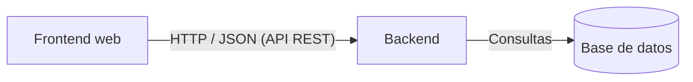

# Arquitectura del sistema

Se adopta una arquitectura cliente-servidor en tres capas.

| Capa | Responsabilidad |
|------|-----------------|
| Presentación (frontend) | Interfaz web, formularios, visualización de datos y validaciones básicas |
| Lógica de negocio (backend) | Reglas del negocio, control de inventario, autenticación y roles |
| Acceso a datos | Persistencia y consulta de la información en la base de datos |

**Justificación.** La separación en capas reduce el acoplamiento, permite trabajar en paralelo en interfaz y servidor, y facilita el mantenimiento y las pruebas de cada parte.
