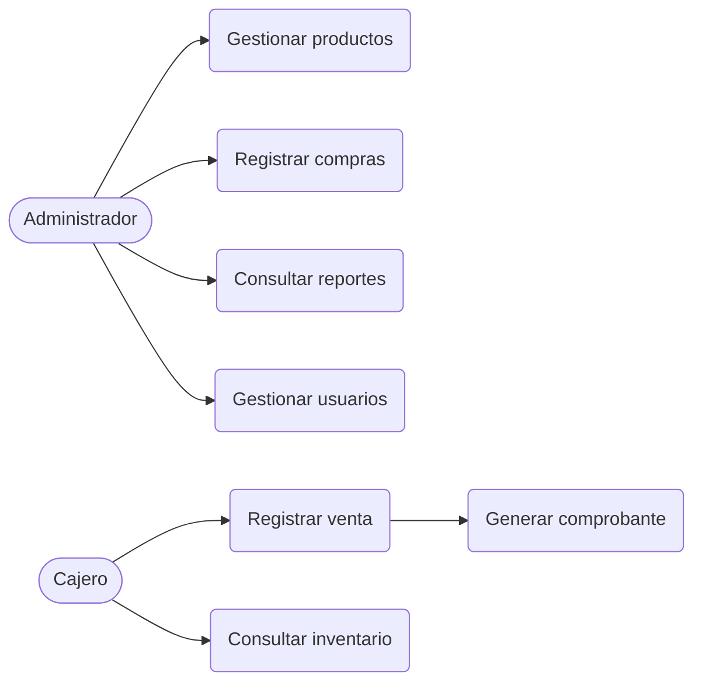
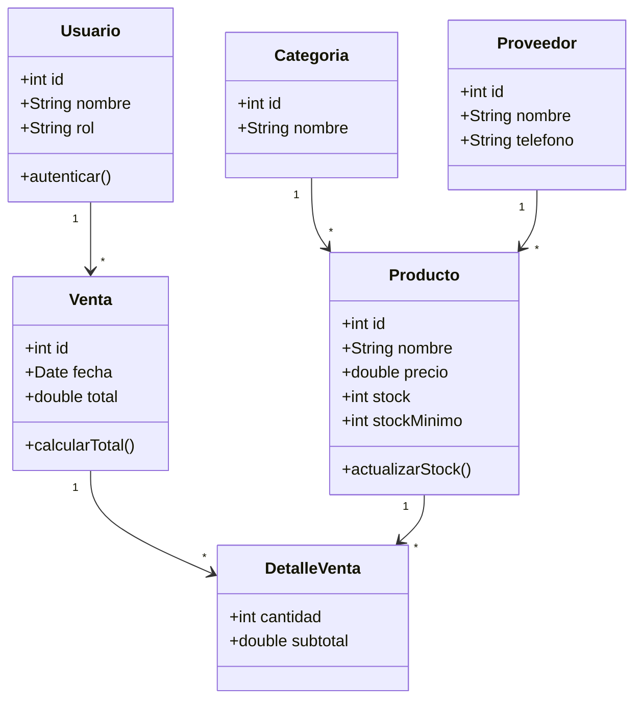
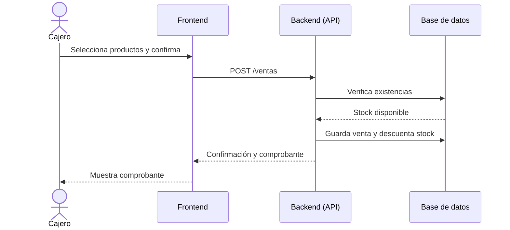
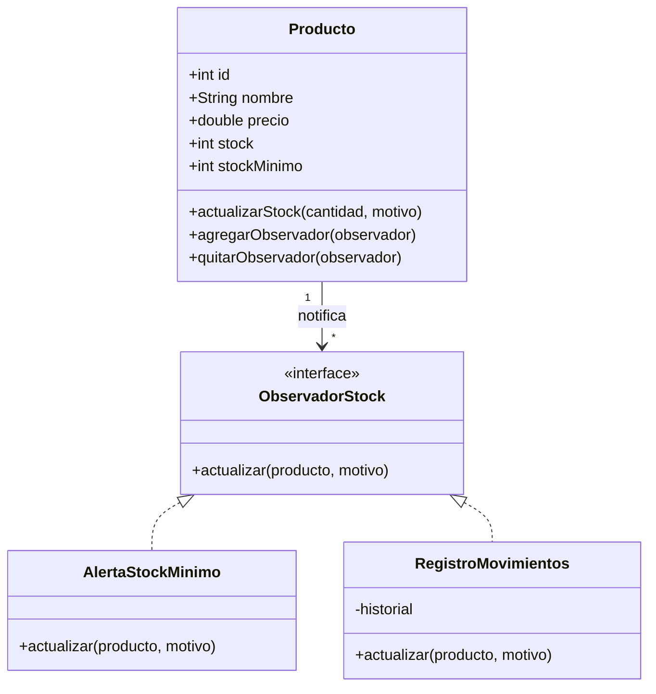
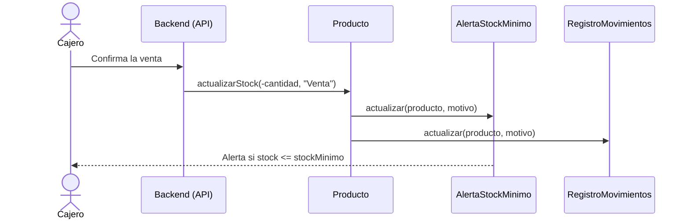

# Modelos UML

## Diagrama de casos de uso

## Diagrama de clases

## Diagrama de secuencia: registrar una venta

## Diagrama de clases v0.2.0: patrón Observer en el control de stock

## Diagrama de secuencia v0.2.0: notificación al registrar una venta

